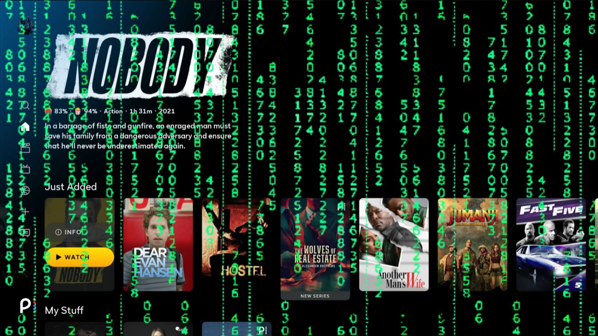
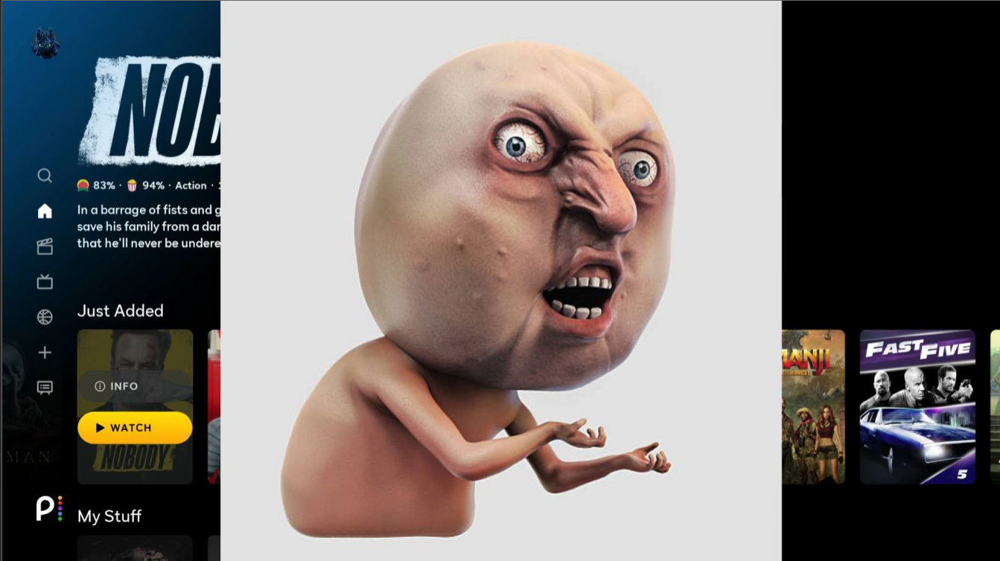

# VizioControl

Python tools for controlling Vizio SmartCast TVs, finding their changing Chrome DevTools ports, and adding temporary image or animated GIF overlays to running web apps.

Tested on a **Vizio V505-G9** with firmware **2.600.596.0-10**. The DevTools bridge was also tested with **Paramount+ on a Vizio V705-H3**. Compatibility depends on the model, firmware, and app.



*Animated Matrix overlay. The screenshot is hosted in this repository and referenced through an immutable GitHub raw URL.*



*A second example: the image bytes are base64-encoded on the computer and sent
inline through DevTools as an image data URL. The TV displays the temporary
overlay without fetching the original image URL. Both local files and downloaded
web images can use this path.*

## Tools

| Script | Purpose |
| --- | --- |
| `vizio.py` | Pair, read device information, control power and inputs, and send remote buttons. |
| `discover_tvs.py` | Discover and identify Vizio TVs with SSDP, validated saved addresses, and an optional subnet scan; show a numbered TV menu. |
| `rediscover_devtools.py` | Find an existing DevTools listener, cache its port, and watch for changes. |
| `vizio_talkback.py` | Enable/disable native Talk Back, set supported speech speed, and speak text through DevTools. |
| `remote_devtools.py` | Send named/raw remote buttons via a supported DevTools key endpoint or explicit PIN-paired HTTPS control. |
| `launch_app_devtools.py` | Request an app launch through the current page's native Vizio bridge using both namespace and app ID. |
| `devtools_bridge.py` | Connect Chrome through a loopback-only bridge when the TV rejects browser WebSocket origins or advertises a broken frontend link. |
| `meme_img_plug.py` | Add/remove an image or GIF through a direct DevTools WebSocket connection, without opening Chrome. |

Use with devices and apps you own or are authorized to test. This is an independent project, not an official Vizio tool.

## Install

Requires **Python 3.9+** and network access to the TV.

```powershell
git clone https://github.com/jsammarco/VizioControl.git
cd VizioControl
python -m venv .venv
.\.venv\Scripts\python.exe -m pip install -r requirements.txt
```

Examples use `python`; activate your environment or substitute `.\.venv\Scripts\python.exe`. The overlay, DevTools app launcher, Talk Back tool, and DevTools mode of the remote require `websocket-client`; the other scripts and paired remote mode use the standard library.

The control, debugger scanner, bridge, overlay, app-launcher, and DevTools remote scripts accept `--host YOUR_TV_IP`. Override the development setup's default LAN address with your TV's address. The app launcher can also discover TVs and offer a selection menu when `--host` is omitted.

## Discover TVs and choose one

The DevTools app launcher discovers TVs when `--host` is omitted. `--discover`
explicitly selects this mode. It displays a numbered menu with each responding
TV's friendly name, model, IP address, and SmartCast API port before connecting
to the chosen TV's debugger:

```powershell
# Choose a TV, find its debugger, and request Hulu:
python launch_app_devtools.py --discover --namespace 2 --app-id 3

# A named app preset also supports the TV menu:
python launch_app_devtools.py --app "Prime Video"

# Choose a TV and only check bridge support; no app is launched:
python launch_app_devtools.py --discover --check

# List TVs and exit without a menu or launch:
python launch_app_devtools.py --list-tvs
```

Discovery sends SSDP `M-SEARCH` requests including
`ST: urn:schemas-kinoma-com:device:shell:1`, with `MX: 1`, plus DIAL and `ssdp:all`
queries. Saved TV addresses in ignored `.local/` files are also rechecked.
Every candidate must return valid Vizio device information on HTTPS port 7345
or the older API port 9000; an arbitrary SSDP responder is not enough.
Only the name, model, address, API port, and discovery sources are returned.
No app is launched by TV discovery or menu selection alone.

Some TVs do not answer SSDP in their current state. To find them without saved
addresses, explicitly include your local subnet (replace the example):

```powershell
python launch_app_devtools.py --discover --scan-subnet 192.168.1.0/24 --app "Hulu"
python discover_tvs.py --scan-subnet 192.168.1.0/24 --select
```

The optional scan checks only the two Vizio API ports and is limited to private
IPv4 subnets of at most 1024 addresses. It does not scan every TCP port.
Standalone `discover_tvs.py` uses only the standard library; run it with `--json`
for machine-readable inventory, or with no arguments to print the numbered list.
`--bind YOUR_LOCAL_IP` selects an SSDP network interface; `--discovery-timeout`
sets its response window (default 3 seconds). Turn on TVs that do not respond.
The live subnet fallback was verified against both test TVs without using saved
addresses. Neither TV answered SSDP during that check.

Enter a listed number to select a TV, or `q` to cancel. No default selection is
made, including when only one TV is found. For unattended commands, use an
explicit `--host` instead. Do not combine `--host` with `--discover`, `--list-tvs`,
or `--scan-subnet`. A supplied `--port` must belong to the selected TV; omit it to
find the current debugger after selection. Discovery does not enable debugging.

## Discover DevTools

Start an app or video player on the TV, then run:

```powershell
python rediscover_devtools.py --host YOUR_TV_IP --open
```

Cached and historical ports are checked first. The scanner then searches high ports before lower ones, checks each open port for actual DevTools targets immediately, and stops on the first confirmed debugger. `--open` opens its discovery page in the default browser.

```powershell
# Rediscover when an app changes ports:
python rediscover_devtools.py --host YOUR_TV_IP --watch --open

# Also repeat the historical discovery/status requests before every new search:
python rediscover_devtools.py --host YOUR_TV_IP --watch --replay --open

# Thorough full-range inventory, continuing after discovery:
python rediscover_devtools.py --host YOUR_TV_IP --full --replay

# Recheck one known port:
python rediscover_devtools.py --host YOUR_TV_IP --ports 45667
```

| Option | Behavior |
| --- | --- |
| Default fast search | 256 workers, 0.2-second TCP timeout, early exit on discovery. |
| `--full` | 128 workers, 0.5-second timeout, scans the whole requested range. |
| `--workers`, `--timeout` | Override either mode's defaults. |
| `--watch` | Poll the active debugger every two seconds; rediscover after it disappears. Ctrl+C stops. |
| `--interval` | Set the watch check interval. |
| `--replay` | SSDP discovery followed by Netflix, Cast, device, power, and AirPlay reads before each search. |
| `--label`, `--output` | Annotate reports or choose their JSON destination. |

The scanner **does not enable debugging**. Existing listeners have been observed for Paramount+, Peacock, and Vizio's web video player. Ports and target IDs can change when app instances restart; static Home may expose none. The exact trigger remains unconfirmed, and replaying status requests does not reliably create a listener.

Watch mode opens a fresh discovery page when it finds a new listener; it does not repair a disconnected inspector window. Fast successes are partial scans, explicitly recorded with `scan_complete`, `ports_scanned`, and `ports_in_range`.

## Connect Chrome through the local DevTools bridge

Some TVs expose a working debugger but supply unusable links on their discovery
page. On the V705-H3 running Paramount+, the advertised frontend revision was
`@000000...` and returned **404**. A working hosted frontend loaded, but its
WebSocket handshake received **403 Forbidden** because the TV rejected its
browser `Origin`. A direct connection without that header succeeded.

First find the current debugger port:

```powershell
python rediscover_devtools.py --host YOUR_TV_IP
```

Then start the bridge, replacing `34363` with the port just discovered:

```powershell
python devtools_bridge.py --host YOUR_TV_IP --port 34363 --listen 9345 --open
```

Keep this process running while using DevTools. `--open` opens a working pinned
hosted frontend in Chrome, with its WebSocket pointed at `127.0.0.1:9345`.
The script prints both hosted and bundled DevTools URLs. If Chrome is not found
in the usual Windows install locations, open the printed hosted URL manually.
Omit `--listen` to choose an available local port automatically. The bridge uses
only the Python standard library.

The bridge binds exclusively to **127.0.0.1**. It validates the request Host and
browser Origin, permits only debugger paths advertised by the selected TV at
startup, and omits `Origin` on the upstream WebSocket handshake. It relays CDP
traffic without recording its contents or changing TV settings. The hosted
frontend runs in your browser; the TV connection travels through your local
bridge. No Chrome security flags or TV launch-flag changes are required.

The first inspectable page is opened. Discovery metadata is captured at startup;
if the app restarts or changes its port/target ID, stop the bridge with **Ctrl+C**,
rediscover, and restart it. It does not enable a missing debugger or automatically
follow app restarts. A 404 for a debugger target can indicate stale metadata.
The pinned frontend worked in this session; other TV browser versions may need
a compatible frontend. The printed bundled URL is another option.

The direct Python overlay client already uses `suppress_origin=True`, so it can
connect without this browser bridge. PIN pairing for normal SmartCast control
remains separate.

## Launch an app through DevTools

`launch_app_devtools.py` connects directly to an existing debugger and calls
`VIZIO.launchApp(NAME_SPACE, APP_ID, MESSAGE, callback)` in the selected page.
This signature was inspected in the running V705-H3 Paramount+ companion library,
and its presence was verified with a read-only check. A successful live app switch
has not yet been verified by this script. The current page must expose the native
bridge; the script does not add the companion library or fall back to another API.

Both **NAME_SPACE and APP_ID** are required for a manual launch:

```powershell
# Verify support without launching anything:
python launch_app_devtools.py --host YOUR_TV_IP --port 34363 --check

# Hulu: namespace 2, app ID 3:
python launch_app_devtools.py --host YOUR_TV_IP --port 34363 --namespace 2 --app-id 3

# Prime Video: namespace 2, app ID 4:
python launch_app_devtools.py --host YOUR_TV_IP --port 34363 --namespace 2 --app-id 4
```

`--name-space` is an alias for `--namespace`. Omit `--port` to discover the
current debugger. Use `--target` with a distinctive page title/URL substring if
several pages are exposed. This connects directly with `Origin` suppressed, so
the browser bridge and an open Chrome window are not needed.

The supplied launch table is stored in `app_launch_catalog.json`, including its
namespace, string app ID, and optional message. Named presets supply all three:

```powershell
python launch_app_devtools.py --list-apps
python launch_app_devtools.py --host YOUR_TV_IP --app "Hulu"
python launch_app_devtools.py --host YOUR_TV_IP --app "Prime Video"
python launch_app_devtools.py --host YOUR_TV_IP --app "Pluto TV"
```

App IDs are text, preserving hexadecimal Cast IDs. `--message` accepts an optional
URL or JSON **string**, and overrides a preset's message. For example, a manual
Pluto TV configuration is:

```powershell
python launch_app_devtools.py --host YOUR_TV_IP --namespace 0 --app-id E6F74C01 --message '{"CAST_NAMESPACE":"urn:x-cast:tv.pluto","CAST_MESSAGE":{"command":"initializePlayback","channel":"","episode":"","time":0}}'
```

A missing message is sent as JavaScript `null`, representing `None` in the table.
The table is historical configuration, not a live availability list. It includes
retired/rebranded services and a duplicate namespace/app ID for Toon Goggles and
Vudu, whose messages differ. Presets preserve those entries rather than guessing
new identifiers. Availability depends on the TV, region, firmware, and service.

The script reports a `SUCCESS` callback as an **accepted launch request**, not
proof that the destination finished loading. Switching apps can close DevTools
before its reply; disconnects/timeouts after sending produce **outcome unknown**
(exit code 2). Check the TV before retrying. No automatic launch retry is made.
It does not extract pairing tokens or print the launch message. Use `--check`
with any launch arguments to validate support without switching apps.

## Native Talk Back and text-to-speech

`vizio_talkback.py` implements the speech path verified on the V705-H3 and V505-G9. It uses
DevTools to access the TV's own settings API, enables the real Talk Back setting,
and sends text to the native speech service. It does not require PIN pairing or
an open Chrome window. A compatible running app must expose a DevTools listener.

```powershell
# Discover TVs, choose one, and speak (enables native Talk Back if needed):
python vizio_talkback.py --discover --say "Hello Joe. This is your TV speaking."

# Select a TV directly; debugger discovery is automatic:
python vizio_talkback.py --host YOUR_TV_IP --say "The speech script is ready."

# Speech speed; --speed is an alias for --rate:
python vizio_talkback.py --host YOUR_TV_IP --rate Fast --say "This is the faster speech setting."
python vizio_talkback.py --host YOUR_TV_IP --rate Normal

# Speak and automatically turn Talk Back off after an estimated playback delay:
python vizio_talkback.py --host YOUR_TV_IP --say "Hello Joe." --auto-disable

# Or choose an explicit delay after the request is accepted:
python vizio_talkback.py --host YOUR_TV_IP --say "Hello Joe." --disable-after 10

# Owner-confirmed on V505-G9: Slow speech with a six-second shutoff delay:
python vizio_talkback.py --host YOUR_TV_IP --say ". Hello Joe. How are you" --rate Slow --disable-after 6

# Read status separately; do not combine --status with --say/--auto-disable:
python vizio_talkback.py --host YOUR_TV_IP --status
python vizio_talkback.py --host YOUR_TV_IP --options

# Native accessibility setting and stop control:
python vizio_talkback.py --host YOUR_TV_IP --enable
python vizio_talkback.py --host YOUR_TV_IP --stop
python vizio_talkback.py --host YOUR_TV_IP --disable

# Read UTF-8 text from a file; --text is an alias for --say:
python vizio_talkback.py --host YOUR_TV_IP --text-file "C:\Notes\speech.txt"
```

The live TV offers **Slow, Normal, and Fast**. Rate names are matched without
case sensitivity against choices retrieved from the TV. No native voice picker
or pitch control was found in the inspected accessibility menu or speech API;
the script does not invent voice/pitch parameters. The browser's separate Web
Speech API reported no voices during this investigation.

**Native settings persist unless automatic shutoff is requested:** speaking
enables Talk Back, which can also cause the TV to read menus aloud. Speech-rate
changes also affect that native setting. Use `--stop` to stop speech or `--disable`
to switch Talk Back off. `--status` and `--options` reject combinations with
mutations, so those checks remain read-only. Both are optional: with no
speech/setting action, the script reads status by default.

`--auto-disable` waits a conservative estimate based on text length and the
actual Slow/Normal/Fast setting, then switches native Talk Back Off and verifies
it. The estimate uses 90/140/190 words per minute, an allowance for long unspaced
text, three seconds of padding, and an eight-second minimum. These are timing
estimates, not measured voice speeds or a speech-completion event. The TV's
`GET /app/tts/play` returned `NOT_SUPPORTED`, `/app/tts/status` returned
`URI_NOT_FOUND`, and the SDK's TTS status listener tracks enabled state rather
than utterance completion.

`--disable-after SECONDS` overrides the estimate and implies automatic shutoff;
choose 1-3600 seconds, enough for the full utterance. The delay starts after the
native playback request is accepted. Switching Talk Back off immediately may
cut off the queued speech: an immediate-off test was not audible to the owner,
while a **10-second delayed** test was heard in full. The script's live delayed
test also verified Talk Back Off and native speech disabled afterward. The owner
subsequently confirmed audible playback on the V505-G9 with the Slow/six-second
example above. Six seconds is specific to that short test phrase; longer text
can require a longer delay or `--auto-disable`.
Results explicitly report `speechCompletionVerified: false` and the timing
method, rather than claiming exact completion detection.

Automatic cleanup also runs after a failed request once speech setup has begun,
uses a fresh token and timeout, and reports failure if Off cannot be confirmed.
The intentional playback delay is added to the desktop's wait budget. Keep the
TV app open until cleanup completes: closing/restarting it destroys the page
context and can prevent cleanup. If the connection is interrupted, verify with
`--status` and use `--disable` as needed. Automatic shutoff turns Talk Back Off
even if it was already On before this command; speech rate is left as selected.

The script detects the accessibility menu layout before changing settings:

| Tested model | Dynamic accessibility menu |
| --- | --- |
| V705-H3 | `/menu_native/dynamic/tv_settings/accessibility` |
| V505-G9 | `/menu_native/dynamic/tv_settings/system/accessibility` |

The writable leaves are `talkback` and `speech_rate` under the selected menu.
Their static-menu counterparts provide valid choices. The older TV returned
`URI_NOT_FOUND` for the newer path, which previously stopped the script at
`options_speech_rate`. The alternate known layout is tried only after that
explicit missing-URI result; authentication, transport, and server errors are
not hidden by fallback attempts. Options, writes, and automatic cleanup all use
the same detected layout. The script reads a fresh `HASHVAL`, writes
`REQUEST: MODIFY`, and verifies the resulting values.
`/app/tts/enabled` is checked to confirm native speech is active; writing to this
read-only endpoint returned `READ_ONLY_ERROR`. Setting the SDK's local
`setTextToSpeechEnabled(true)` alone had not enabled native speech on this TV.
Actual playback uses `PUT /app/tts/play` with `{"VALUE":"text"}`; stop uses the
companion library's single-space payload.

Temporary authorization remains in a local variable inside the TV page. Only
sanitized status returns to Python; neither credentials nor speech text are
printed or saved by the script. Text input is limited to 20 KiB. No power-state
queries are made. Settings may have changed before a later operation fails;
results include confirmed changes, and interrupted writes report an unknown
outcome without automatic replay. Read `--status` before retrying after a lost
connection. Server acceptance does not independently prove audible output.

Discovery failures are reported before any speech/settings action is sent. An
unknown-outcome warning is reserved for failures after a potentially mutating
DevTools evaluation has started, rather than merely having speech arguments on
the command line. If no TVs respond, use a known `--host` or an explicit subnet
scan.

The same TV discovery/menu options are supported, including `--list-tvs`,
`--scan-subnet`, and `--bind`; use `--port` to bypass debugger discovery or
`--target` to select an exposed page. Live verification confirmed native Talk Back
**On**, the **Fast** setting followed by restoration to **Normal**, and acceptance
of speech playback through this script. A live V505-G9 test also accepted the
speech request and verified automatic shutoff using its older menu layout.
Audible playback was confirmed by the TV owner on both models, including the
scripted Slow/six-second example on the V505-G9.

## Remote buttons: DevTools and PIN-paired control

`remote_devtools.py` supports **KEYPRESS**, **KEYDOWN**, and **KEYUP**, named
buttons, raw codes, and multi-key sequences. It performs no power-state queries
and implements no Wake-on-LAN. The transport must be selected explicitly for
PIN-paired control; DevTools remains the default.

### PIN-paired mode for TV-wide buttons

On the tested V705-H3, the TV-local API at `127.0.0.1:7346` returns HTTP 500
`Unhandled Exception` for the key-command route. Both slash variants failed.
Removing the CORS obstacle did not make that route work, and the internal
bootstrap token was rejected by the HTTPS control service as `INVALID_TOKEN`.
Use normal PIN pairing for global buttons such as mute and volume on this TV:

```powershell
# Choose a TV, then press Volume Up through its paired SmartCast API:
python remote_devtools.py --discover --transport paired --button volume-up

# Address the TV directly:
python remote_devtools.py --host YOUR_TV_IP --transport paired --button mute-toggle

# Request/restart pairing without sending any buttons:
python remote_devtools.py --host YOUR_TV_IP --transport paired --pair

# Check an existing pairing without requesting a new code or pressing buttons:
python remote_devtools.py --host YOUR_TV_IP --transport paired --check
```

**Pairing is never requested automatically.** If credentials are missing when a
button is requested, or `--pair` is selected, the script first asks:

```text
TV YOUR_TV_IP: request a pairing code on the TV now? [y/N]
```

Only `y` or `yes` sends a request to display the code. Enter, `n`, cancellation,
or EOF sends neither a pairing request nor buttons. Enter the four-digit PIN at
the hidden prompt, or `q` to cancel the pending pairing. Pairing can temporarily
interrupt the app display. A button command explicitly supplied on the same
invocation is sent after successful pairing; `--pair` alone sends no buttons.

Credentials are saved to the ignored per-TV file `.local/remote-YOUR_TV_IP.json`.
An existing matching-host credential in `.local/tv.json` can be reused. A config
for a different TV is rejected. `--config PATH` chooses another pairing file;
`--api-port` overrides the paired HTTPS port (normally 7345). Credentials are
plaintext local data and are never printed. The four-digit PIN is not saved.
A rejected saved credential does not cause an automatic new pairing request;
run `--pair` to request a new pairing, again with confirmation.

This mode uses `vizio.py`'s HTTPS client and authenticated `PUT /key_command/`,
without requiring a debugger, Chrome, or `websocket-client`. It is a separate
transport from the DevTools path. Its pairing/button handling is covered by
simulated tests; no live pairing or real TV buttons were sent during this fix.

### DevTools mode and route checks

```powershell
# Check the actual key route with an empty KEYLIST; no buttons sent:
python remote_devtools.py --discover --check

# On firmware that accepts the TV-local key endpoint:
python remote_devtools.py --host YOUR_TV_IP --button up right ok
```

DevTools mode evaluates JavaScript that gets temporary TV-local authorization
from `http://127.0.0.1:7346/app/get_auth_token`, then calls the TV-local
`PUT /key_command/`. A successful token lookup is **not** proof that key sending
works. Every invocation first probes the key route with an empty KEYLIST. If
that probe fails, the real buttons are not sent and the script reports the
backend status. This was verified live on the V705-H3: HTTP 500, zero keys sent.

`cdp_key_session.py` supplies narrowly scoped CORS response handling for that
exact key URL through the current debugger session. It preserves the original
HTTP status and is disabled when the session finishes. It does not use
`mode: no-cors`, disable browser security globally, or turn server errors into
successes. Only sanitized status is printed. Never log raw CDP interception
events: they can contain authorization headers. No token or response body is
printed or persisted by these helpers, and no token is put in a page global.

Use `--port` for a known debugger or omit it to discover the current listener;
`--target` selects among exposed pages. Both transports support TV discovery,
`--list-tvs`, `--scan-subnet`, `--bind`, and `--discovery-timeout`.

### Button names, raw codes, and sequences

```powershell
python remote_devtools.py --list-buttons
python remote_devtools.py --host YOUR_TV_IP --transport paired --codeset 5 --code 4 --action KEYPRESS
python remote_devtools.py --host YOUR_TV_IP --transport paired --button volume-up --action KEYDOWN
python remote_devtools.py --host YOUR_TV_IP --transport paired --button volume-up --action KEYUP
```

Use KEYUP to release a button previously held with KEYDOWN. The default action
is KEYPRESS. Multiple names create one ordered KEYLIST. For mixed actions, save
a JSON array or an object containing only `KEYLIST`, for example:

```json
{"KEYLIST":[
  {"CODESET":5,"CODE":1,"ACTION":"KEYPRESS"},
  {"CODESET":5,"CODE":0,"ACTION":"KEYPRESS"}
]}
```

```powershell
python remote_devtools.py --host YOUR_TV_IP --transport paired --sequence-file buttons.json
```

Sequences are limited to 100 commands and 64 KiB files; no per-key delays are
inserted. Input is validated before connecting. Named buttons include navigation,
home/back/menu, play/pause, volume, mute, input cycling, channels, and power.
An accepted API response does not prove the current app acted on the button.
A lost response after sending is reported as **outcome unknown** (exit code 2),
with no automatic retry. DevTools mode cannot wake a TV whose debugger is off.

## Image and GIF overlays without Chrome

```powershell
python meme_img_plug.py --host YOUR_TV_IP
python meme_img_plug.py --host YOUR_TV_IP --remove
```

Pass a local image or animated GIF to encode and display it automatically:

```powershell
python meme_img_plug.py --host YOUR_TV_IP --image-file "C:\Pictures\matrix.gif"
python meme_img_plug.py --host YOUR_TV_IP --image-file "C:\Pictures\my image.png"
```

`--image-file` supports GIF, PNG, JPEG, and WebP. It reads the file, detects the
format from its contents, base64-encodes the original bytes, and sends a data URL
directly to the TV. GIF frames and transparency are preserved; the image is not
uploaded to a hosting service or added to the repository. Choose either
`--image-file` or `--image-url`. Missing or unsupported files fail before scanning
or connecting to the TV.

The script discovers the debugger, connects directly to its page WebSocket, and inserts one uniquely identified image. It uses fixed positioning, **100% viewport height and width**, `object-fit: contain`, and **z-index 2147483647**. Pointer events pass through, and successful image loading and element dimensions are checked.

The default `IMAGE_URL` near the top of the script contains an embedded animated GIF. Accepted sources are:

- HTTP or HTTPS image URLs: downloaded on your computer and automatically encoded as base64.
- Complete data URLs such as `data:image/gif;base64,...`.
- Raw base64: validated and wrapped with the detected GIF, PNG, JPEG, or WebP MIME type.

```powershell
python meme_img_plug.py --host YOUR_TV_IP --image-url "https://example.com/image.gif"
python meme_img_plug.py --host YOUR_TV_IP --port 45667
python meme_img_plug.py --host YOUR_TV_IP --target Paramount
python meme_img_plug.py --host YOUR_TV_IP --replay
```

For long base64 values, edit the quoted `IMAGE_URL` string rather than passing it through Windows command-line arguments. Web images are downloaded on your computer, validated, base64-encoded, and sent inline to the TV, just like local files. The TV does not need access to the original image host. Original bytes, including GIF frames and transparency, are preserved.

Web downloads follow ordinary HTTP redirects, use a 20-second socket timeout and
a 20 MiB size limit, and verify HTTPS certificates normally. Browser cookies and
TV/app credentials are not sent to the image host. Use a direct image URL, not an
HTML page containing an image. GIF animation is handled by the TV browser, and
the page must allow `data:` images.

The overlay disappears on page reload/app restart. Re-running reuses its element; `--remove` removes only that element. Multiple exposed pages require `--target`. Omit `--port` to rediscover after an app restart.

Page policies can block images. CSS z-index cannot guarantee placement above native/protected video planes or browser top-layer UI. No persistent TV settings are changed.

## Pair and control the TV

Normal SmartCast control uses PIN pairing separately from DevTools discovery.

```powershell
python vizio.py --host YOUR_TV_IP pair-start
python vizio.py pair-finish
```

Read the four-digit PIN on the TV and enter it at the prompt; input is not echoed. Use `pair-cancel` to cancel a pending challenge. If the code expires, cancel and start again. Pairing can temporarily interrupt the app display.

```powershell
# Read information:
python vizio.py info
python vizio.py status
python vizio.py inputs
python vizio.py current-input
python vizio.py current-app
python vizio.py --output data\snapshot.json snapshot

# Control:
python vizio.py input HDMI-1
python vizio.py power off
python vizio.py power on
python vizio.py key volume-up
python vizio.py key mute-toggle
python vizio.py key home
python vizio.py key --help
```

Use exact input names returned by `inputs`. The script validates names and reads a fresh input hash before writing. Power-on requires network standby/Quick Start support; the script does not change that setting automatically.

Global `vizio.py` options precede the command. The paired host is saved; changing it clears the previous token and challenge. `get /relative/path` reads known API endpoints. `snapshot` reads device, power, input, app, audio, system, and Cast metadata, recording unsupported sections as errors.

## Local data and credentials

These locations are excluded from Git:

| Location | Contents |
| --- | --- |
| `.local/tv.json` | Plaintext pairing credential/pending challenge. |
| `.local/devtools-ports.json` | Per-TV debugger-port cache. |
| `data/` | Device snapshots and scan reports. |
| `*.log`, `.venv/`, `__pycache__/` | Logs, local environments, and Python cache files. |

Do not upload these files or unredacted app console/network exports. Logs can contain session tokens; snapshots can contain device identifiers. Token/password/secret fields are redacted in `vizio.py` output, but not every report or third-party app log is safe to share.

The TV's vendor HTTPS certificate does not match its LAN IP. The local API client uses a dedicated context with certificate verification disabled. HTTP requests bypass machine-wide proxies; browser and OS security settings are unchanged.

## Troubleshooting

| Symptom | What to check |
| --- | --- |
| No responding Vizio TVs found | No speech or settings command was sent. Turn the TV on, try `--scan-subnet CIDR` or `--bind YOUR_LOCAL_IP`, or bypass TV discovery with `--host YOUR_TV_IP`. |
| Talk Back `--status` usage error | Run `python vizio_talkback.py --host YOUR_TV_IP --status` separately from `--say`, `--auto-disable`, or setting changes. |
| No debugger | TV on, app/video player running, correct address. Try `--full`; the current state may expose no listener. |
| Discovery link returns 404 | An invalid all-zero frontend revision may be advertised. Use `devtools_bridge.py --open` with the current debugger port. |
| Frontend loads but WebSocket receives 403 | The TV may reject the browser Origin. Use the loopback bridge and keep it running. |
| Inspector disconnected | App instances may restart with a new port and target ID. Rediscover or use watch mode. |
| HTTP 403 for inputs/settings | Complete PIN pairing for normal control. |
| Image fails to load | Source format, network access, and the page's image policy. |
| Black video in the preview | Native/protected video may be absent from DevTools screenshots even while it plays on the TV. |

## Tests

```powershell
python -m unittest -v
```

Tests cover pairing prerequisites, input validation/hashes, redaction, cached/early-exit discovery, watch replay/reconnection, CDP response handling, target selection, and image validation. Bridge tests use a local simulated debugger to check metadata rewriting, WebSocket forwarding, Origin removal, and rejection of unexpected origins/targets. Launcher tests cover paired identifiers, preset messages, hexadecimal IDs, CDP replies, and callback outcomes; optional JavaScript behavior tests use Node.js when installed. TV discovery tests cover SSDP queries, candidate validation/deduplication, bounded subnet scans, explicit menu selection, cancellation, and listing without debugger commands. Remote tests cover button mappings, action/sequence validation, scoped CORS handling, backend error preservation, empty-list readiness checks, explicit pairing consent/cancellation, host-bound credentials, exact key payloads, and interrupted requests. Talk Back tests cover read-only status, validated rates, fresh setting hashes, enabling before speech, text/file validation, injection-safe text, credential/text omission, stopping, rejected writes, lost replies, fixed/estimated automatic shutoff, cleanup failure, and fresh authorization for cleanup, both accessibility menu layouts, and discovery/pre-evaluation failures without false unknown-outcome warnings. Tests do not send live control commands or modify a TV.

## References

- [SmartCast API research](https://github.com/exiva/Vizio_SmartCast_API)
- [pyvizio](https://github.com/raman325/pyvizio)
- [Chrome DevTools Protocol](https://chromedevtools.github.io/devtools-protocol/)
